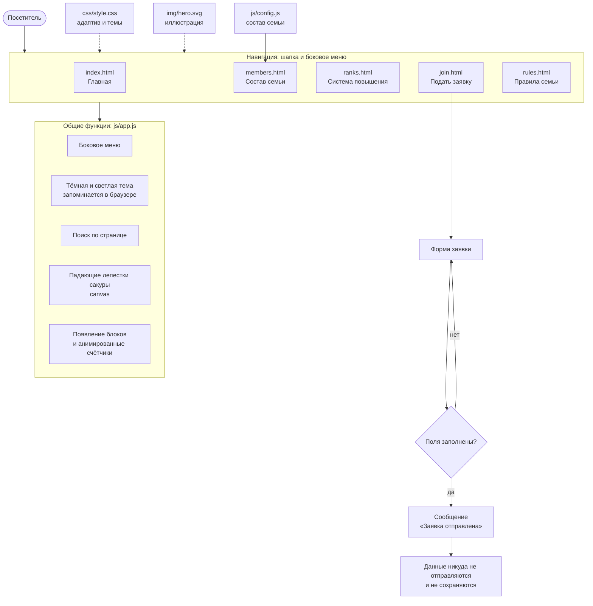

# 🌸 Skyborn — сайт-визитка семьи

## Описание

Skyborn — многостраничный сайт-визитка игровой семьи на сервере Majestic RP (Portland).
Сайт рассказывает о семье: кто в неё входит, как устроена система повышения, какие действуют правила, и позволяет заполнить анкету для вступления.

Сайт полностью статичный (HTML + CSS + JavaScript): серверная часть и установка не нужны. Форма заявки только показывает сообщение «Заявка отправлена»: данные никуда не передаются и нигде не сохраняются.

## 🚀 Функциональность

- [x] Адаптивный дизайн (компьютер, планшет, телефон)
- [x] Тёмная/светлая тема (кнопка 🌙/☀️ в шапке, выбор запоминается в браузере)
- [x] Навигация между страницами (шапка и боковое меню)
- [x] Поиск по контенту (кнопка 🔎 в шапке: фильтрует карточки текущей страницы)
- [x] JS эффекты некоторых элементов дизайна сайта:
  - падающие лепестки сакуры (canvas-анимация);
  - плавное появление блоков при прокрутке;
  - анимированные счётчики на главной;
  - выезжающее боковое меню;
  - валидация и анимация отправки формы заявки.

## 📁 Структура проекта

```
skyborn-site/
├── index.html      # Главная страница
├── members.html    # Состав семьи
├── ranks.html      # Система повышения
├── join.html       # Подать заявку (форма)
├── rules.html      # Правила семьи
├── css/
│   └── style.css   # Стили, адаптив, тёмная и светлая темы
├── js/
│   ├── config.js   # Данные сайта (состав семьи)
│   └── app.js      # Шапка, меню, тема, поиск, анимации, форма
├── img/
│   └── hero.svg    # Главная иллюстрация (сакура, гора, луна)
├── LICENSE
└── README.md
```

### Схема сайта



## 🌐 GitHub Pages

Сайт доступен по адресу: https://sirexu.github.io/Site/

Как опубликовать:
1. Загрузите все файлы в репозиторий так, чтобы `index.html` лежал в корне.
2. Откройте Settings → Pages → Branch: `main`, папка `/ (root)` → Save.
3. Через минуту сайт откроется по адресу выше.

Локально сайт можно открыть двойным щелчком по `index.html` или через расширение Live Server в VS Code.

## 👥 Разработчики

SRX — DEV

## 📄 Лицензия

Проект распространяется по лицензии MIT — см. файл [LICENSE](LICENSE).
